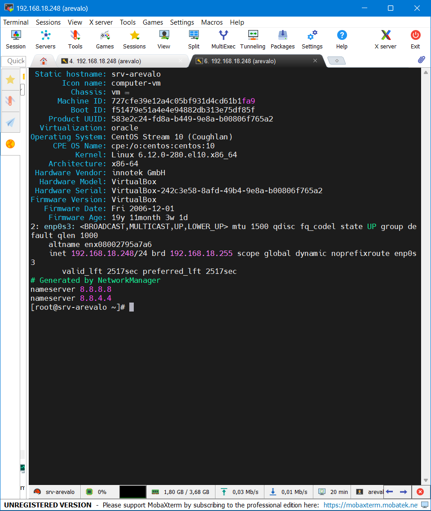
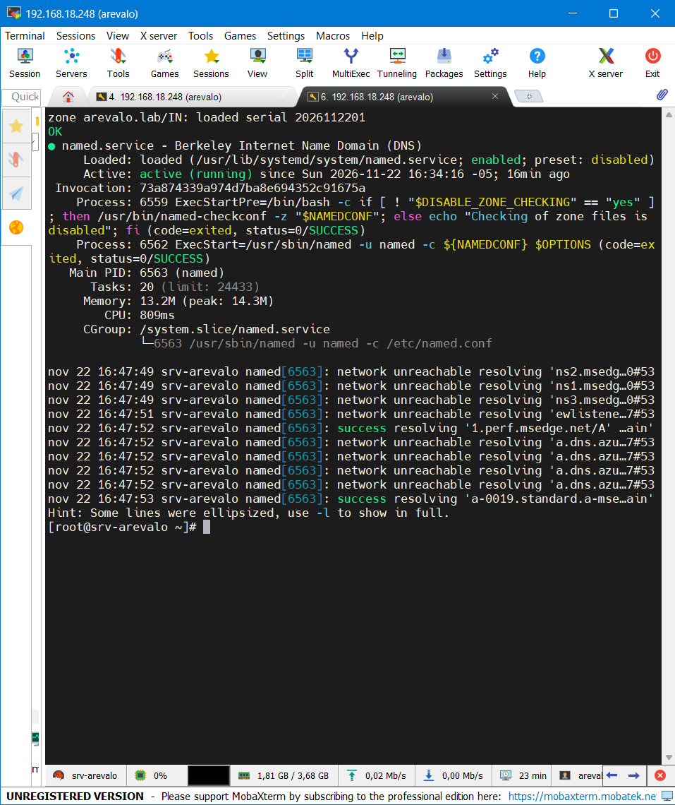
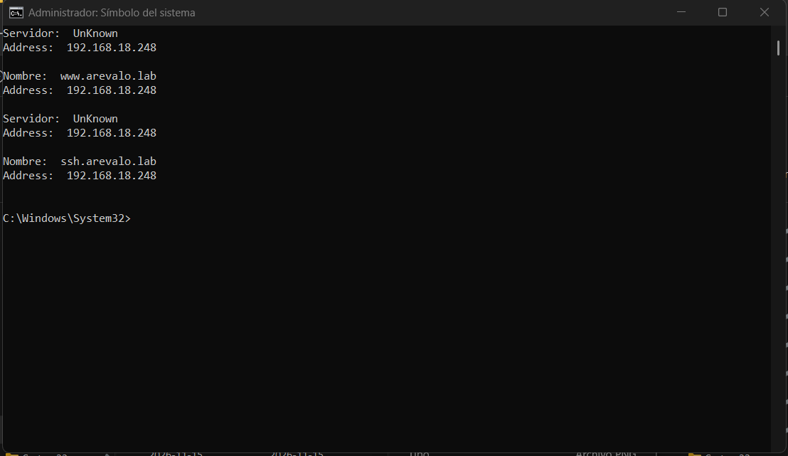
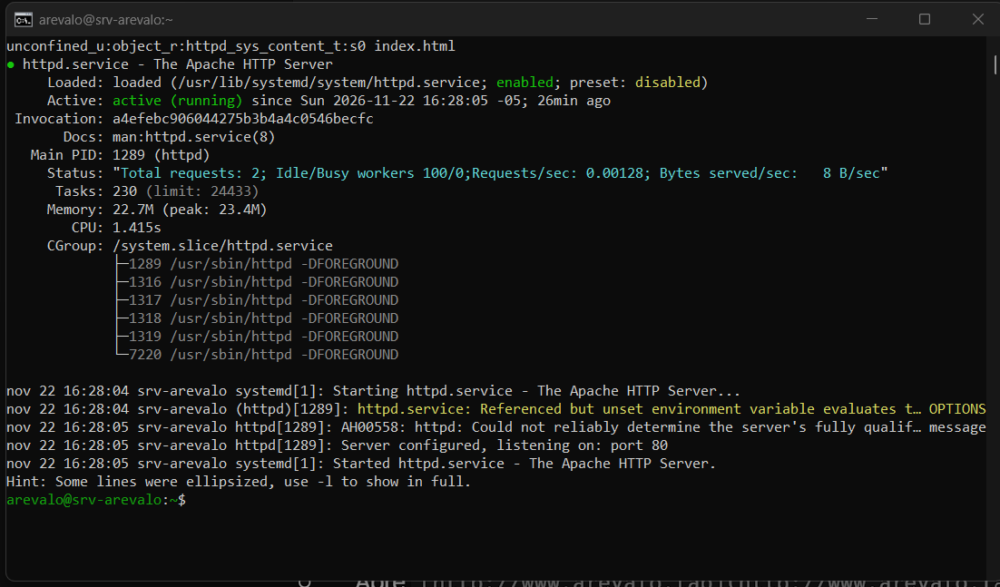
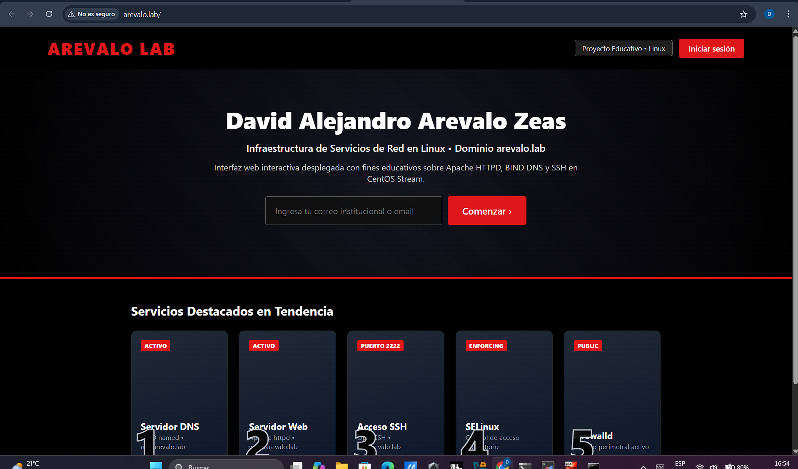
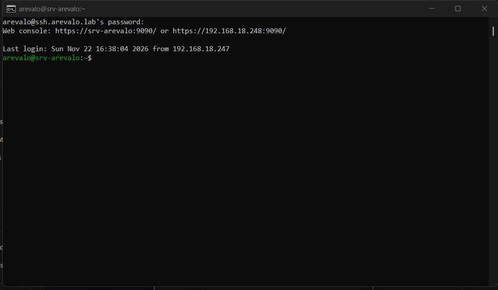
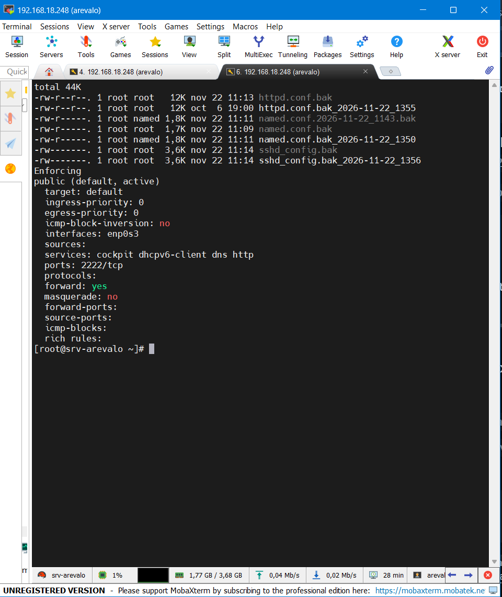

# Informe Técnico: Despliegue, Aseguramiento y Validación de Servicios de Red en Linux

**Autor:** David Alejandro Arevalo Zeas  
**Modalidad:** Individual  
**Sistema Operativo Servidor:** CentOS Stream 10 (`srv-arevalo`)  
**Kernel:** `Linux 6.12.0-280.el10.x86_64`  
**Dominio Local:** `arevalo.lab`  
**Dirección IPv4 Servidor:** `192.168.18.248/24`  
**Fecha:** 22 de noviembre de 2026  

---

## 1. Resumen Ejecutivo

El presente informe documenta la arquitectura, configuración, endurecimiento (*hardening*) y validación funcional de una infraestructura de servicios esenciales de red sobre **CentOS Stream 10** (`srv-arevalo`). Se implementaron de forma integrada los servicios de resolución de nombres (**BIND DNS**), servidor web (**Apache HTTP**) y administración remota segura (**OpenSSH**), operando bajo políticas de control de acceso obligatorio (**SELinux en modo `Enforcing`**) y filtrado perimetral activo mediante **Firewalld**.

### Matriz de Servicios Implementados

| Servicio | Demonio | Puerto / Protocolo | Registro DNS (`arevalo.lab`) | Política SELinux | Estado |
| :--- | :--- | :--- | :--- | :--- | :--- |
| **DNS Autoritativo** | `named` | `53/TCP`, `53/UDP` | `ns1.arevalo.lab` | `named_t` | Activo (`running`) |
| **Servidor Web** | `httpd` | `80/TCP` | `www.arevalo.lab` | `httpd_sys_content_t` | Activo (`running`) |
| **Administración Remota** | `sshd` | `2222/TCP` | `ssh.arevalo.lab` | `ssh_port_t` | Activo (`running`) |

---

## 2. Arquitectura de Red e Identidad del Servidor

El servidor opera virtualizado sobre VirtualBox en modalidad de **Adaptador Puente** conectado a la subred local `192.168.18.0/24`, permitiendo comunicación directa con equipos cliente de la red LAN sin traducción de direcciones (NAT):

* **Hostname:** `srv-arevalo`
* **Interfaz activa:** `enp0s3` (`192.168.18.248/24`, difusión `192.168.18.255`)
* **Cliente de pruebas:** Estación Windows (`192.168.18.247`) configurada para utilizar `192.168.18.248` como servidor DNS primario.

---

## 3. Implementación y Validación por Servicio

### 3.1. Servicio DNS Autoritativo (BIND / `named`)
Se configuró BIND como servidor autoritativo para la zona directa `arevalo.lab` (`/var/named/arevalo.lab.zone`, serial `2026112201`), resolviendo los registros de tipo `A` para `ns1.arevalo.lab`, `www.arevalo.lab` y `ssh.arevalo.lab` hacia `192.168.18.248`.

* **Validación de sintaxis:** `named-checkzone arevalo.lab /var/named/arevalo.lab.zone` retornó `OK`.
* **Validación desde cliente:** Las consultas `nslookup www.arevalo.lab` y `nslookup ssh.arevalo.lab` ejecutadas en Windows resolvieron correctamente a través del servidor `192.168.18.248`.

---

### 3.2. Servicio Web HTTP (Apache / `httpd`)
Se desplegó Apache HTTPD escuchando en el puerto `80/TCP` con una interfaz web interactiva personalizada (**AREVALO LAB** — *David Alejandro Arevalo Zeas*) alojada en `/var/www/html/index.html` con fines académicos.

* **Contexto SELinux:** Se verificó mediante `ls -Z /var/www/html` que `index.html` posee la etiqueta `unconfined_u:object_r:httpd_sys_content_t:s0`.
* **Acceso por dominio:** Al acceder desde el navegador web a `http://www.arevalo.lab`, la interfaz carga correctamente mostrando los módulos activos del laboratorio.

---

### 3.3. Administración Remota Segura (OpenSSH)
Para mitigar ataques automatizados contra el puerto estándar `22/TCP`, se endureció la configuración de OpenSSH (`/etc/ssh/sshd_config`):
* Cambio de puerto de escucha a **`2222/TCP`**.
* Deshabilitación del acceso remoto directo del superusuario (`PermitRootLogin no`).
* Restricción de acceso exclusivamente al usuario administrativo sin privilegios `arevalo` (`AllowUsers arevalo`).
* Registro del puerto `2222/TCP` bajo el tipo `ssh_port_t` en SELinux y apertura en `firewalld`.

---

## 4. Seguridad Perimetral, Respaldos y Resolución de Incidentes

### 4.1. Auditoría de Seguridad y Gestión de Respaldos
Antes de aplicar modificaciones sobre los archivos críticos del sistema, se crearon respaldos con marca de tiempo en `/root/backups_interciclo/` (`httpd.conf.bak`, `named.conf.bak`, `sshd_config.bak`). El sistema mantiene activo **SELinux en estado `Enforcing`** y **Firewalld** en la zona `public` permitiendo únicamente los servicios `cockpit`, `dhcpv6-client`, `dns`, `http` y el puerto `2222/tcp`.

### 4.2. Incidentes Resueltos (Troubleshooting)
1. **Reconfiguración de subred tras cambio de red local:** Al trasladar la infraestructura a la red `192.168.18.0/24`, se renovó la dirección IP en `enp0s3` (`192.168.18.248`) y se actualizaron las directivas de escucha y registros `A` en BIND (`/etc/named.conf` y `/var/named/arevalo.lab.zone`), verificando la integridad mediante `named-checkzone`.
2. **Prioridad DNS IPv6 en cliente Windows:** El sistema operativo cliente priorizaba servidores DNS IPv6 del enrutador residencial sobre el servidor DNS IPv4 local, provocando errores `NXDOMAIN`. Se solucionó deshabilitando el enlace IPv6 (`ms_tcpip6`) en la interfaz Wi-Fi y purgando la caché DNS (`ipconfig /flushdns`).
3. **Control de privilegios administrativos:** Se garantizó que las tareas de auditoría de respaldos (`/root/backups_interciclo/`) y reinicio de demonios se ejecuten bajo sesión privilegiada `root`, manteniendo la separación de roles frente al usuario operativo `arevalo`.

---

## 5. Conclusiones

La infraestructura desplegada cumple con los estándares de disponibilidad, resolución interna de nombres y seguridad perimetral requeridos en entornos empresariales Linux. La combinación de **SELinux en modo `Enforcing`**, reglas granulares en **Firewalld**, separación de privilegios en **SSH (puerto `2222`)** y respaldo preventivo de configuraciones asegura la integridad operativa de todos los servicios bajo el dominio `arevalo.lab`.
